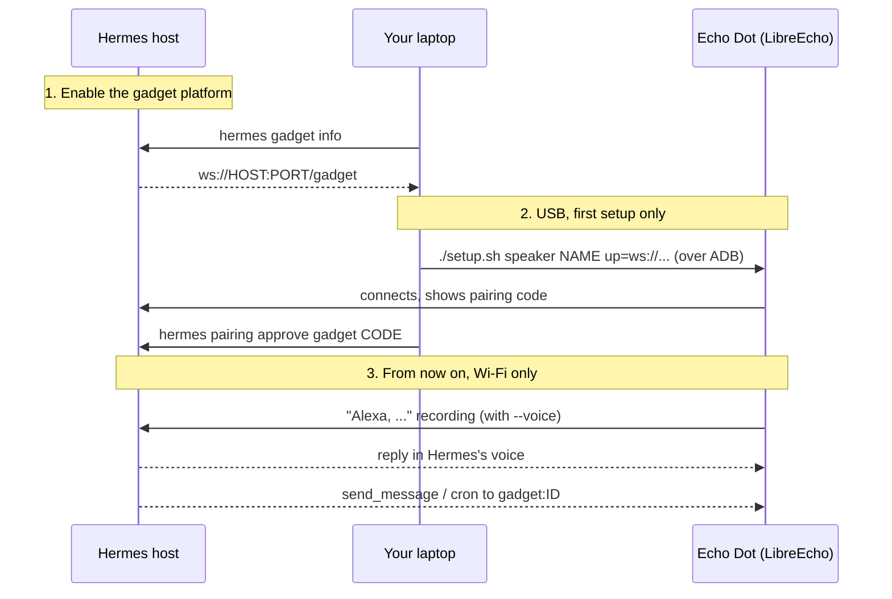

# libreecho-hermes-speaker

Make an Echo Dot 2nd Gen running [LibreEcho](https://github.com/aslater3/LibreEcho) a speaker, and optionally a microphone, for one or more [Hermes](https://github.com/NousResearch/hermes-agent) agents.

1. **Get the gadget URL from Hermes:** `hermes gadget info`
2. **Plug the Dot in over USB**, once
3. **Run** `./setup.sh speaker "Kitchen Echo" hermes-03=ws://HOST:PORT/gadget --voice hermes-03`



## 1. Get the URL from Hermes

Install and enable the gadget plugin on the Hermes host ([Hermes integration guide](https://github.com/Adolanium/hermes-gadget-sdk/blob/main/docs/hermes-integration.md)):

```sh
hermes plugins install "https://github.com/Adolanium/hermes-gadget-sdk.git#plugin" --enable
hermes gadget info        # prints "device URL: ws://...:8765/gadget"
```

In a container, use the host's published port instead of the container IP it prints.

## 2. Plug in over USB

Flash with [LibreEcho's installer](https://github.com/aslater3/LibreEcho/blob/main/docs/install/README.md) and leave the Dot booted on USB. The host needs `adb`, `curl` and `python3`. `./setup.sh devices` should list it; it uses ADB server port 5038 (LibreEcho's flashing container), so set `ADB_PORT=5037` to use the host's usual server.

USB is needed because LibreEcho gives root only over ADB, and installing needs root. After setup the Dot runs over Wi-Fi and survives reboots. You need USB again only to change the config, unless you add [root SSH](#root-ssh-optional).

## 3. Run setup

```sh
./setup.sh speaker "Kitchen Echo" hermes-03=ws://HOST:8766/gadget hermes-01=ws://HOST:8767/gadget --voice hermes-03
```

- Each `NAME=URL` is one Hermes. The Dot pairs with each separately, with its own key, and plays their messages one at a time.
- Approve each pairing code on its Hermes: `hermes pairing approve gadget CODE`.
- `--voice NAME` sends "Alexa, …" to that one Hermes, which answers on the Dot. Leave it out for speaker only; rerun without it to turn voice off.
- Logs: `./setup.sh logs`. With several Dots on USB, put `--serial SERIAL` before the command: `./setup.sh --serial SERIAL logs`.

## Notes

- **Voice:** LibreEcho keeps its wake word and end-of-speech detection; the client stands in as its speech-to-text server and forwards the recording. Hermes transcribes it with its own `stt` settings. LibreEcho's own assistant stays silent. Recordings run up to 15 s.
- **One wake word, one voice target.** Speech goes to the `--voice` upstream; every upstream can still speak.
- **Security:** plain `ws://` is for a trusted network; use `wss://` otherwise.
- **Uninstall:** remove `/data/libreecho/local/hermes-gadget` and `/data/libreecho/local/services/hermes-gadget`, then reboot to stop the running client.
- **Checks:** `python3 tests/test_voice_relay.py` (needs `websockets`).

## Root SSH (optional)

For development: key-only root SSH on port 2222, so config changes don't need USB.

```sh
./setup.sh root-ssh ~/.ssh/id_ed25519.pub
ssh -p 2222 root@DEVICE_IP
```

It creates `/data/libreecho/local/enabled`, which starts **all** installed local services, not just SSH. Anyone with a listed key is root on the device. Remove `/data/libreecho/local/services/root-ssh` and reboot to turn it off.
