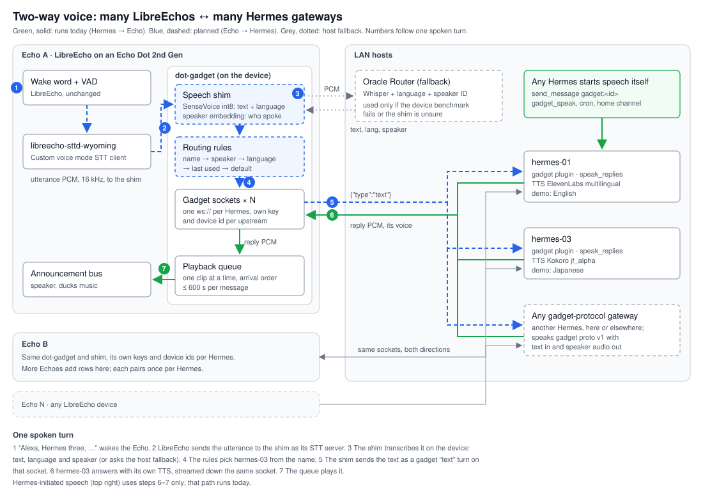

# Two-way voice: LibreEcho ↔ Hermes gateways

Status: **plan**. This page is the plan of attack for letting people talk *to*
Hermes through a LibreEcho device, on top of the speaker path that already runs.
No device code changes yet.

## Goal

Any number of LibreEcho devices each talk with any number of Hermes gateways,
or anything else that speaks the [Hermes Gadget protocol](https://github.com/Adolanium/hermes-gadget-sdk/blob/main/docs/protocol.md).
Each device understands several languages and tells its regular speakers apart
**on the device itself**. It picks the gateway from the name that was said, who
said it and the language it was said in. Each gateway answers in its own voice
and language. Gateways can still speak on their own without being asked.

**Done when** we have a recording of one Echo Dot 2nd Gen holding a two-way
conversation with `hermes-01` in English, then with `hermes-03` in Japanese
(see [Demo](#demo)).

## What runs today: Hermes → Echo (steps 6–7)

- `dot-gadget` on each Echo holds one gadget WebSocket per Hermes. Each socket
  has its own device key and id, paired with `hermes pairing approve gadget CODE`.
- Hermes renders speech with its own `tts:` settings and streams PCM down that
  socket. A reply, `send_message` to `gadget:<id>`, `gadget_speak`, cron delivery and
  the home channel all use this path.
- `dot-gadget` is the only writer to LibreEcho's announcement bus. It plays one
  clip at a time in arrival order, across every Hermes.
- Upstream pieces: hermes-gadget-sdk #305 (proactive speech), #327 (queue and
  overflow) and #331 (`gadget_speak`), all merged.

## The attack: Echo → Hermes (steps 1–5)

The gadget protocol already carries speech from a device: `{"type":"text"}`, or
`audio.start` followed by PCM frames. Hermes answers either one with
`speak_replies`, down the same socket. So the reverse path needs **no Hermes
changes and no new host service**. It needs a shim inside `dot-gadget` that
turns the Echo's speech into a `text` turn on the right socket.

1. **Wake.** LibreEcho's own wake word and VAD run unchanged.
2. **Capture.** LibreEcho is set to **Custom** voice mode with its Wyoming STT
   server at `127.0.0.1:10300`, which is the shim in `dot-gadget`. The shim
   receives each utterance as Wyoming `audio-chunk` events, 16 kHz mono PCM16.
3. **Understand, on the device.** With [sherpa-onnx](https://github.com/k2-fsa/sherpa-onnx)
   (armv7 build), the shim runs:
   - **SenseVoice-Small int8** for speech-to-text in English, Japanese, Chinese,
     Korean and Cantonese. It also returns the language of the utterance.
   - **A speaker embedding** (CAM++ or a WeSpeaker ResNet, about 7–30 MB),
     compared with the voices enrolled on that device.
4. **Route.** These rules run in this order, and the first one that matches wins:
   1. **Name.** A gateway named right after the wake word ("Hermes one",
      "Hermes three", and aliases such as "Hermes 1", "ハーミーズ", "エルメス").
      The name is removed from the text.
   2. **Speaker.** The enrolled speaker's home gateway. This is for
      personalisation, not authentication: a voice match never unlocks anything.
   3. **Language.** A gateway whose TTS speaks the detected language, if only
      one does.
   4. **Follow-up.** The gateway this device last talked with, within 90 s, so
      follow-ups need no name.
   5. **Default.** The device's default gateway.
5. **Send.** The shim sends `{"type":"text","id":…,"text":…}` on that gateway's
   socket. It returns an empty Wyoming `transcript` to LibreEcho, so the
   built-in assistant says nothing.
6. **Answer.** Hermes runs a normal turn and speaks the reply with its own TTS.
   In the demo, `hermes-01` uses ElevenLabs multilingual and `hermes-03` uses
   Kokoro `jf_alpha`.
7. **Play.** The reply goes through the same queue as all other speech.

### Why on the device

- **Fits on paper.** An Echo Dot 2nd Gen has four Cortex-A53 cores at 1.3 GHz
  (32-bit userspace under LibreEcho) and about 480 MB of RAM. About 317 MB is
  free while LibreEcho runs. SenseVoice-Small int8 is about 230 MB and is
  reported at RTF 0.44 on one Cortex-A55 thread. A speaker embedding adds
  7–30 MB.
- **LibreEcho already runs sherpa-onnx on the device** for its built-in English
  STT, so the runtime is proven there.
- **The built-in model can't do this job.** It's English-only. On a Japanese
  test sentence it returned unrelated English, at CER 1.87.
- **No round trip.** Speech, voiceprints and language stay on the device. Only
  the text goes to the gateway the rules picked.

The numbers above are spec-sheet and earlier measurements. **Milestone 1 measures
them on the device**, and that measurement decides the design.

### Fallback: host router

If SenseVoice doesn't fit in memory next to LibreEcho, or is too slow, the shim
sends the audio over Wyoming to a router on a LAN host instead. The router runs
Whisper large-v3 or turbo plus the same language and speaker steps, and returns
the same three answers: text, language and speaker. Routing, sending and
playback stay on the device. The shim can also use the host only for low-score
utterances.

### Out of scope for now

- **Switching language in the middle of a sentence.** Each utterance gets one
  language. Parallel per-language encoders such as LR-MoE cost more than twice
  a single encoder, which is too much for this device.
- **Separate wake words per Hermes** ("Hey Hermes1", "Hey Hermes2"). LibreEcho
  loads exactly one wake model. One custom "Hey Hermes" model is possible later.
- **Sending raw audio to Hermes** (`audio.start`). We need the text before we
  know which Hermes to send it to. This stays a fallback for a device with one
  upstream.

## Milestones

Each milestone ends with a check on a real Echo Dot 2nd Gen.

0. **Spike.** Point Custom mode's STT at a throwaway Wyoming server on the
   device that logs the audio and returns `""`. Check that the assistant stays
   silent and that wake detection still works after a reply has played. One
   playback was once seen to stop wake detection until a reboot. Also check
   whether the wake phrase appears in the transcript, and whether LibreEcho
   stops sending at end of speech.
1. **Benchmark (go/no-go).** Run sherpa-onnx armv7 with SenseVoice-Small int8,
   CAM++ and a language check on the device while LibreEcho is running. Record
   peak RSS, RTF and load time, plus CER on an English set and a Japanese set.
   - **Go:** peak memory leaves at least 40 MB free, RTF ≤ 0.5, and Japanese
     CER ≤ 0.15.
   - **No-go:** use the host router and keep the on-device shim for later.
2. **Gateways current.** Install the gadget plugin at `35dbae7` or later
   (#327, #331) on each gateway. Check that a typed `text` turn from a test
   client is answered with speech.
3. **Shim.** Add the Wyoming server and the sherpa-onnx calls to `dot-gadget`.
   Models download to `/data` and are checked by SHA-256. Check that a canned
   WAV sent to `127.0.0.1:10300` comes back as a `text` turn on one upstream.
4. **Rules and enrolment.** Add the name, speaker, language, follow-up and
   default rules. Add `./setup.sh enroll NAME` to record voiceprints, which stay
   on the device. Add host-side unit tests for English and Japanese
   transcripts, including how SenseVoice spells the names.
5. **Setup.** Extend `./setup.sh speaker` with `--default NAME`,
   `NAME:alias,alias` and `--stt-fallback tcp://HOST:PORT`.
6. **Demo.** Record it as described below.

## Demo

On one Echo Dot 2nd Gen, with both gateways paired and `hermes-01` as the
default:

| # | Said | Expect |
|---|---|---|
| 1 | "Alexa, Hermes one, what's a good name for a houseplant?" | `hermes-01` answers in English, in its ElevenLabs voice |
| 2 | "Alexa, give me another one." | A follow-up within 90 s. It still goes to `hermes-01`, in English |
| 3 | "Alexa, ハーミーズ・スリー、観葉植物の名前を考えてください。" | `hermes-03` answers in Japanese, in Kokoro `jf_alpha` |
| 4 | "Alexa, もう一つお願いします。" | A follow-up. It still goes to `hermes-03`, in Japanese |

Record the room audio next to a terminal showing `./setup.sh logs` and both
gateways' logs. For each turn, the logs show the detected language, the speaker,
which rule fired, which gateway got the text, and how long each step took.

## Risks and open questions

- Whether SenseVoice fits in memory next to LibreEcho's own services. Milestone 1
  decides this.
- SenseVoice may misspell the gateway names, so the aliases are tuned against
  real recordings in milestone 4.
- Voiceprints are biometric data. They stay on the device, are deleted with
  `./setup.sh enroll --forget NAME`, and are never sent to a gateway.
- The links are plain `ws://` and Wyoming TCP on the LAN, as the speaker path
  is today. Text goes only to a gateway this device has paired with.
- Hermes stops its outgoing stream when a device *records* (`audio.start`). A
  `text` turn doesn't do that, so the shim aborts the clip that is playing when
  the wake word fires.

## Background

- [hermes-gadget-sdk](https://github.com/Adolanium/hermes-gadget-sdk) #305,
  #327 and #331; [LibreEcho](https://github.com/aslater3/LibreEcho) #370.
- [sherpa-onnx](https://github.com/k2-fsa/sherpa-onnx),
  [SenseVoice](https://github.com/FunAudioLLM/SenseVoice),
  [3D-Speaker / CAM++](https://github.com/modelscope/3D-Speaker).
